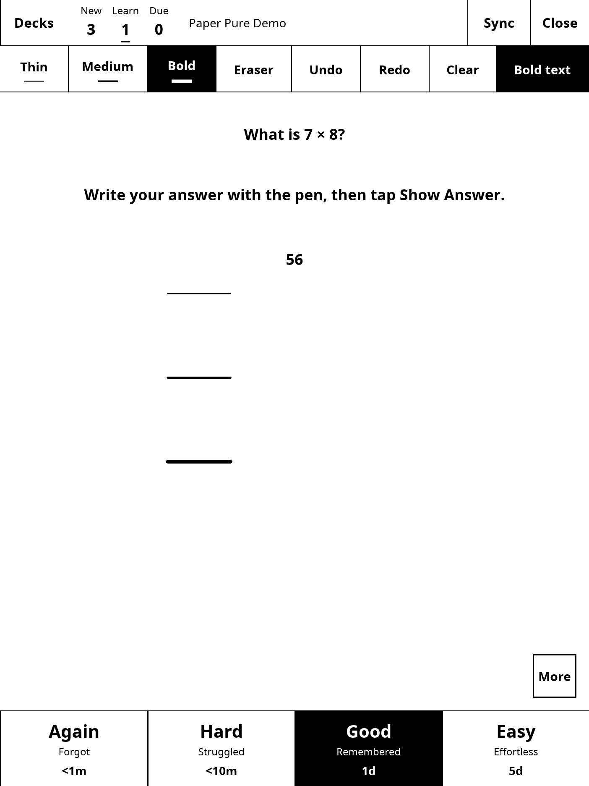

# Testing Anki on Paper Pure

Run `./scripts/test.sh` for the automated suite. It creates temporary collections and a localhost sync server, without using an AnkiWeb account or an existing collection.

The suite checks:

- Paper Pure's 1404 × 1872 display and AppLoad RGB888 format 7.
- Pen coordinate endpoints, nonzero digitizer minimums, clamping, and inverted portrait.
- Saved zoom, pen weight, and bold-text settings.
- Marker button taps firing once on lift, with writing gestures excluded.
- Tip/proximity release ending strokes when a pressure release is missing.
- Distinct pressure-sensitive stroke weights, eraser replay, ink undo/redo, and undoable Clear.
- True monochrome controls and selected-tool contrast.
- Bold card text increasing ink coverage on a white background.
- Concurrent clipped renders producing identical frames.
- Grading, undo, and review persistence after reopening a collection.
- Visible action buttons covering their full touch regions.
- Current `.apkg` import/export preserving content and image files.
- Deck/media download and review upload through Anki's real self-hosted sync server.

The build also runs installer contracts in an isolated filesystem, verifying that a failed transfer leaves the previous executable intact and that a successful update preserves configuration and review data. Run `tests/installer_contract.py` in the math-builder container to repeat these checks independently.

## Device acceptance

The port was exercised on Paper Pure firmware **3.28.0.172** and AppLoad **0.6.0**, in normal portrait. The tablet reported an Elan marker with X range 0–9620, Y range 0–13000, and pressure range 0–4096. The app discovers these ranges at runtime.

Observed checks include launch, deck selection, answer reveal, grading, persistent review counts, and app exit. In version 0.2.0, synthetic Marker events passed through the real input device to select decks and tools, reveal answers, and operate Undo/Redo/Clear. Thin, Medium, and Bold strokes at the same pressure measured 3, 5, and 9 pixels on the live framebuffer. Eraser-end events removed ink, undo restored it, and undoing Clear restored all sketch pixels. Bold text changed the card while preserving ink, answer reveal retained the sketch, and the captured frame contained only monochrome pixels. Fractions, summations, and Greek symbols rendered on the tablet with the bundled math helper.

Synthetic input verifies the event-to-display path. Physical Marker feel, eraser behavior, sustained handwriting with palm rejection, pinch/scroll comfort, and inverted portrait need human acceptance testing. AnkiWeb has not been tested with a real account; self-hosted sync is covered by the automated round trip.

The original reMarkable application checksum was verified unchanged after installation and exit, and the OS partition remained read-only. Launcher settings are temporary; reboot restores the stock interface.
